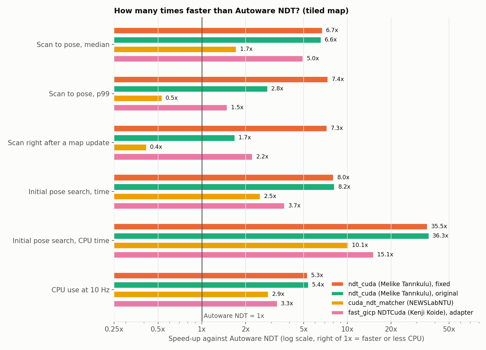

# Autoware NDT GPU Benchmark

This benchmark compares Autoware's NDT scan matcher, which runs on the CPU, with three GPU implementations of NDT. Every option runs inside Autoware's own localization loop, on Autoware's sample data. The repository has everything that you need to get the same results: pinned versions, patches, data, scripts and the raw results of every run.

Documentation and all results: <https://xmfcx.github.io/autoware-ndt-gpu-benchmark/>

## Result

Tiled map, NVIDIA GeForce RTX 3090, AMD Ryzen 9 5900X:

| Option | CPU at 10 Hz (% of one core) | GPU at 10 Hz (% busy) | Scan to pose, median / p99 (ms) | Initial pose search (s) | Poses vs Autoware NDT, median |
| --- | --- | --- | --- | --- | --- |
| Autoware NDT (CPU) | 17.6 | 0 | 5.0 / 9.0 | 4.1 | 0.4 mm (run to run) |
| ndt_cuda (Melike Tanrıkulu), original | 3.3 | 0.23 | 0.76 / 3.2 | 0.50 | 1.1 mm |
| ndt_cuda (Melike Tanrıkulu), fixed | 3.3 | 0.21 | 0.75 / 1.2 | 0.51 | 0.8 mm |
| fast_gicp NDTCuda (Kenji Koide), adapter | 5.3 | 0.45 | 1.0 / 6.0 | 1.1 | 296 mm |
| cuda_ndt_matcher (NEWSLabNTU) | 6.2 | 0.89 | 2.9 / 17.0 | 1.6 | 3.9 mm |



The options:

- Autoware NDT: [autowarefoundation/autoware_core](https://github.com/autowarefoundation/autoware_core)
- ndt_cuda by Melike Tanrıkulu: [meliketanrikulu/ndt_cuda](https://github.com/meliketanrikulu/ndt_cuda)
- cuda_ndt_matcher by NEWSLabNTU (National Taiwan University): [NEWSLabNTU/cuda_ndt_matcher](https://github.com/NEWSLabNTU/cuda_ndt_matcher)
- fast_gicp NDTCuda by Kenji Koide: [koide3/fast_gicp](https://github.com/koide3/fast_gicp)

## Quick start

You need Ubuntu 24.04, ROS 2 Jazzy, an NVIDIA GPU, the CUDA 12.8 toolkit and a built Autoware. The [Reproduce](https://xmfcx.github.io/autoware-ndt-gpu-benchmark/reproduce/) page has every step.

```bash
git clone https://github.com/xmfcx/autoware-ndt-gpu-benchmark.git
cd autoware-ndt-gpu-benchmark
echo "AUTOWARE_DIR=$HOME/autoware" > config/local.env
scripts/download_data.sh
scripts/setup_workspaces.sh
harness/run_one.sh ndt_cuda_fix my_first_run
harness/run_matrix.sh
python3 harness/summarize.py results/runs results/summary
python3 harness/make_plots.py results/runs results/summary.json docs/assets/figures
```

## Repository layout

| Path | Content |
| --- | --- |
| `config/` | Configuration, pinned versions, the Autoware repository list, data checksums |
| `harness/` | The run, analysis and plot scripts, and the launch files of the test |
| `scripts/` | Data download, workspace setup, input recording |
| `patches/` | Patches to the options (the ndt_cuda fix, the port to current Autoware, the fast_gicp adapter) |
| `overlays/` | The launch overlay that starts cuda_ndt_matcher in place of Autoware's node |
| `results/` | `summary.md`, `summary.json` and the per-run data of the published results |
| `tools/` | The timing test of the ndt_cuda copy stall |
| `docs/` | The documentation site (Zensical) |

## Related

- autowarefoundation/autoware#6905 (the proposal of cuda_ndt_matcher for Autoware)
- meliketanrikulu/ndt_cuda#2 (the fix of the map upload stall)
- meliketanrikulu/ndt_cuda#3 (the port of the integration to current Autoware)

## License

Apache License 2.0, see [LICENSE](LICENSE). [NOTICE](NOTICE) lists the third-party parts.
