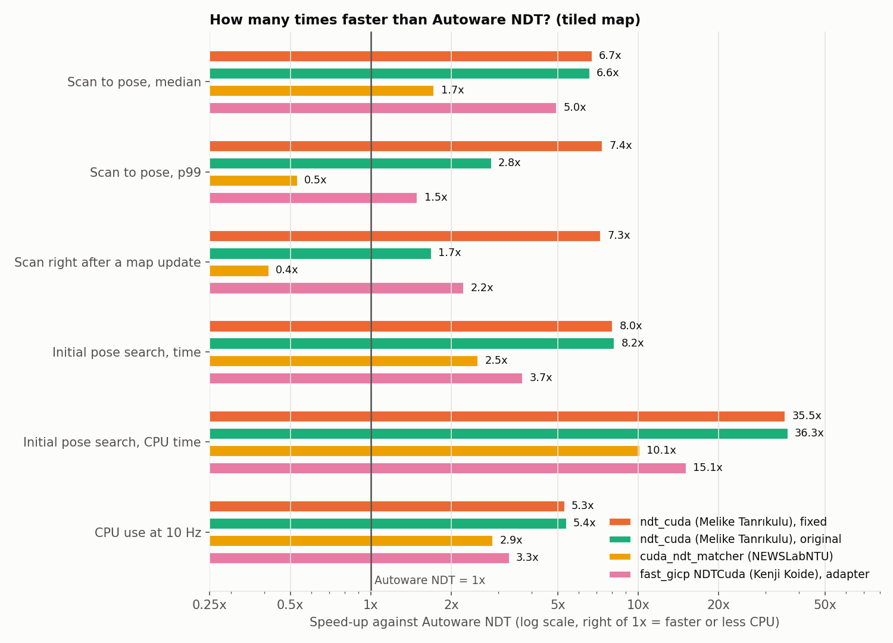

# Autoware NDT GPU benchmark

This benchmark compares Autoware's NDT scan matcher, which runs on the CPU, with three GPU implementations of NDT (normal distributions transform, the lidar-to-map matching that Autoware uses for localization). Every option runs inside Autoware's own localization loop, on Autoware's sample data. The repository has everything that you need to get the same results: pinned versions, patches, data, scripts and the raw results of every run.

## Result

At the real 10 Hz scan rate, the GPU options cut the CPU use of localization by 2.8 to 5.3 times, and the time of the initial pose search by 2.5 to 8 times. ndt_cuda (Melike Tanrıkulu), with the fix from this benchmark, is the lightest on every measure. Its poses match Autoware's NDT to below a millimeter (median).

| Option | CPU at 10 Hz (% of one core) | GPU at 10 Hz (% busy, RTX 3090) | Scan to pose, median / p99 (ms) | Initial pose search (s) | Video memory (MiB) | Poses vs Autoware NDT, median |
| --- | --- | --- | --- | --- | --- | --- |
| Autoware NDT (CPU) | 17.6 | 0 | 5.0 / 9.0 | 4.1 | 0 | 0.4 mm (run to run) |
| ndt_cuda (Melike Tanrıkulu), original | 3.3 | 0.23 | 0.76 / 3.2 | 0.50 | 262 | 1.1 mm |
| ndt_cuda (Melike Tanrıkulu), fixed | 3.3 | 0.21 | 0.75 / 1.2 | 0.51 | 264 | 0.8 mm |
| fast_gicp NDTCuda (Kenji Koide), adapter | 5.3 | 0.45 | 1.0 / 6.0 | 1.1 | 282 | 296 mm |
| cuda_ndt_matcher (NEWSLabNTU) | 6.2 | 0.89 | 2.9 / 17.0 | 1.6 | 770 | 3.9 mm |

The table is for the tiled map, where dynamic map loading swaps map tiles while the vehicle drives. About 250 MiB of each video memory value is the CUDA context. p99 is the time within which 99% of the scans got their pose.

## The options

| Option | Owner | Repository |
| --- | --- | --- |
| Autoware NDT (CPU) | Autoware Foundation | [autowarefoundation/autoware_core](https://github.com/autowarefoundation/autoware_core) |
| ndt_cuda | Melike Tanrıkulu | [meliketanrikulu/ndt_cuda](https://github.com/meliketanrikulu/ndt_cuda) |
| cuda_ndt_matcher | NEWSLabNTU (National Taiwan University) | [NEWSLabNTU/cuda_ndt_matcher](https://github.com/NEWSLabNTU/cuda_ndt_matcher) |
| fast_gicp NDTCuda | Kenji Koide | [koide3/fast_gicp](https://github.com/koide3/fast_gicp) |

[The options](options.md) has the owners, versions, and how each option plugs into Autoware.

## How the benchmark works

The test runs the smallest part of Autoware that still closes the localization loop: the map loader, the scan matcher, the EKF (extended Kalman filter) and the pose initializer. A bag replays the inputs, which one full Autoware replay of the sample rosbag recorded once. So every option gets exactly the same inputs. One run takes about 13 seconds, and the full matrix of 79 runs takes about 20 minutes. [Method](method.md) has the details.

## Pages

- [Results](results.md): all tables and charts.
- [The ndt_cuda fix](ndt-cuda-fix.md): a map upload stall in ndt_cuda and its fix.
- [Open loop](open-loop.md): the options with the same initial guess for every scan, and why Autoware's pose output has 4 to 8 mm steps.
- [Findings](findings.md): what the results show.
- [Code review](code-review.md): the source-level review of the options.
- [Reproduce](reproduce.md): run the benchmark yourself.
- [Data](data.md): the dataset and where it comes from.
