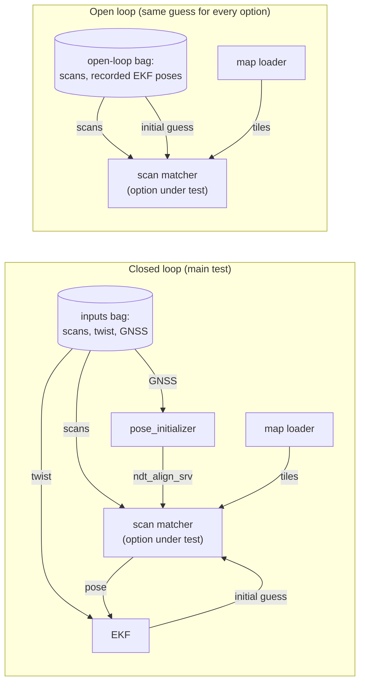

# Method

## What runs

The test runs the NDT localization loop of Autoware, not the whole stack:

- `autoware_pointcloud_map_loader`, which serves the map to NDT.
- The scan matcher under test.
- The EKF (`pose_twist_fusion_filter` launch), which fuses each NDT pose with the twist and gives NDT the initial guess for the next scan. The loop stays closed.
- `autoware_pose_initializer`, for the initial pose search (map height fit, then `ndt_align_srv`, then EKF and NDT activation).

The inputs are the downsampled scan, the twist from `gyro_odometer`, and the GNSS pose. They are not in the sample bag (it holds raw Velodyne packets, IMU, GNSS fix and vehicle status), so one full Autoware replay produced them once. None of them depends on the scan matcher, so every variant gets identical inputs. All nodes use Autoware's own launch and parameter files.

Two maps:

- Single-file map: the sample map as one PCD file. The map loads once, and no tiles change during the drive.
- Tiled map: the same points split into 279 tiles of 20 m (`harness/split_map.py`, with `pointcloud_map_metadata.yaml`), as the Autoware documentation recommends. With Autoware's defaults (`map_radius` 150 m, `update_distance` 20 m), the drive causes 5 map updates of 7 to 15 tiles each.

The scan matcher process runs on 4 dedicated physical cores (CPUs 0-3 and their SMT siblings 12-15). Everything else runs on the other 8 cores. The built-in NDT uses its default 4 OpenMP threads.

## Limits

- One machine with a desktop GPU. Jetson AGX Orin results can differ a lot, because its GPU is about 5 times smaller and its CPU cores are slower. The relative order is likely to hold, but the numbers do not transfer.
- Short data and a small map. Larger maps have more voxels per update, so the map update effects (and the benefit of the fix) are larger there.
- The CPU numbers are for the whole node process, so they include ROS 2 overhead (DDS, executors).
- The fast_gicp adapter is my own code. Its numbers show what fast_gicp costs inside Autoware's node, not how fast_gicp performs in its own applications.
- GPU busy time comes from one traced run per option. Nsight Systems adds overhead, so the traced runs are not used for the latency or CPU columns.
- The real-time (1x) numbers come from one run per option.
