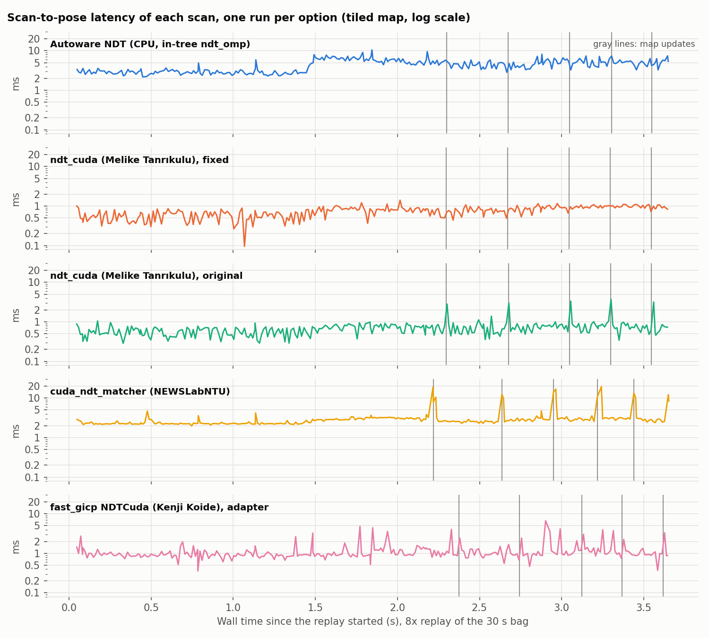

# The ndt_cuda fix

The problem: Autoware's map update thread builds the new map in a second NDT object, copies it, and swaps the copy in under a short lock (`MapUpdateModule::update_map_internal()`). In the original ndt_cuda, the copy constructor creates an empty GPU state, so the first `align()` of the copy merges all tiles, builds the hash table and uploads the map. That first `align()` runs in the scan callback, while it holds the NDT lock.

The fix: an uploaded GPU map never changes, because every `setTarget()` makes new buffers. So copies now share the device buffers of the original through a `shared_ptr`, and need no upload. A copy also allocates its scratch buffers when it is made, which in Autoware is the map update thread. This also removes the second copy of the map from video memory.

| ndt_cuda (Melike Tanrıkulu), tiled map, 8x | Original | Fixed |
| --- | --- | --- |
| Scan right after a map update, median | 3.54 ms | 0.82 ms |
| Scan right after a map update, max | 4.22 ms | 1.00 ms |
| All scans, p99 | 3.19 ms | 1.23 ms |
| All scans, max | 4.22 ms | 1.49 ms |
| All scans, median | 0.76 ms | 0.75 ms |

The sample map is small (about 10000 voxels at 2 m). The stall grows with the number of voxels: in a separate test with 36000 voxels the first `align()` of a copy took 3.2 ms before the fix and 0.46 ms after (0.43 ms for a normal call).

The fix passes all four ndt_cuda test suites (GPU-less parity tests against koide3/ndt_omp and tier4/ndt_omp, and the GPU tests). Patches against meliketanrikulu/ndt_cuda `192919b`:

- `patches/ndt_cuda/0001-fix-gpu_backend-share-the-uploaded-map-between-copies.patch`: the library change (`gpu_backend.hpp`, `gpu_backend.cu`, `impl/ndt_cuda.hpp`, and the CPU emulation used by the tests).
- `patches/ndt_cuda/0002-feat-integrations-autoware-support-the-NDT-interface.patch`: the integration header for Autoware main. Autoware now passes the scan to `align()` and asks `hasTarget()`. Without it, ndt_cuda does not compile against Autoware main.
