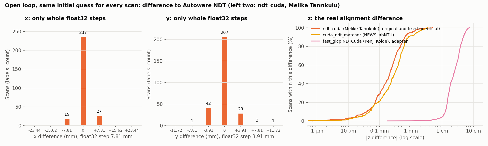

# Open loop: same initial guess for every scan

In the closed loop, each NDT pose changes the next initial guess, so small differences carry forward. The open-loop test removes that effect. Only the map loader and the scan matcher run. The bag plays the EKF poses (`biased_pose_with_covariance`) of one closed-loop run of Autoware NDT, so every option aligns every scan from exactly the same guess. `harness/make_open_loop_bag.py` writes that bag statically from the recorded scans and EKF poses. Single-file map, 8x, 3 runs per option. The reference is the first open-loop run of Autoware NDT, and poses are matched per scan by time stamp.

| Option | Same iteration count | Same x and y float value | z diff median / p95 / max (µm) | Rotation diff median / max (deg) | 3D diff median / max (µm) | TP diff median | NVTL diff median |
| --- | --- | --- | --- | --- | --- | --- | --- |
| Autoware NDT, runs 2 and 3 | 100% | 100% | 0 / 0 / 0 | 0 / 0 | 0 / 0 | 0 | 0 |
| ndt_cuda (Melike Tanrıkulu), original | 92.2% | 62.5% | 211 / 1073 / 4879 | 0.0015 / 0.046 | 429 / 14087 | 0.0020 | 0.0003 |
| ndt_cuda (Melike Tanrıkulu), fixed | 92.2% | 62.5% | 211 / 1073 / 4879 | 0.0015 / 0.046 | 429 / 14087 | 0.0020 | 0.0003 |
| cuda_ndt_matcher (NEWSLabNTU) | 90.5% | 48.2% | 298 / 1648 / 3468 | 0.0021 / 0.039 | 3906 / 11729 | 0.0049 | 0.0006 |
| fast_gicp NDTCuda (Kenji Koide), adapter | 37.8% | 0% | 23319 / 55934 / 71922 | 0.17 / 0.52 | 59124 / 197677 | 0.0311 | 0.0167 |

What the open-loop test shows:

1. Autoware NDT is deterministic. Its three open-loop runs give bit-identical poses, scores and iteration counts. So the run-to-run differences of the closed loop (up to about 27 mm) come from the replay timing and the EKF, not from NDT.
2. The output pose cannot resolve x and y below 4 to 8 mm in this map. Autoware's NDT keeps the pose as a float matrix (`Eigen::Matrix4f`) in map coordinates. At x = 89571 m and y = 42301 m, float32 values are 7.8125 mm and 3.90625 mm apart. Every x and y difference in the table is exactly 0 or a whole number of these steps. This holds for Autoware's own NDT too, so the millimeter maxima of all comparisons are mostly rounding steps.
3. The z coordinate is near 0, so float32 does not limit it. Its difference shows how far the alignments really differ: 0.2 mm (median) between ndt_cuda and Autoware NDT, with identical inputs.
4. The remaining difference comes from how far Autoware lets NDT converge. With `trans_epsilon: 0.01` and no line search, NDT stops after about 2.2 iterations, before the pose settles at the optimum. So small numeric differences in the steps change the result: ndt_cuda computes per point in float and Autoware's in-tree ndt_omp in double. On 8% of the scans the two take a different number of iterations, which moves the pose by up to one step. A test with tighter limits (`trans_epsilon` 1e-3, 1e-4, 1e-5, up to 100 iterations) did not help. Both implementations then used all 100 iterations on most scans, so without a line search Autoware's NDT does not settle closer than about a millimeter. Those runs are not part of the published results.
5. The original and fixed ndt_cuda give identical results. The fix changes only where the map upload runs, not the math.

ndt_cuda's README reports micrometer agreement. That test compares one alignment against tier4/ndt_omp and koide3/ndt_omp, which use the same float formulation, on scans with small coordinates. The README also reports that with the map shifted by 47 km, the results agree at the millimeter level, which matches the float32 steps found here. This benchmark compares against Autoware's in-tree copy (double precision) in map coordinates near 90 km, inside Autoware's node with Autoware's stop criteria. Both results are correct for what they measure.
