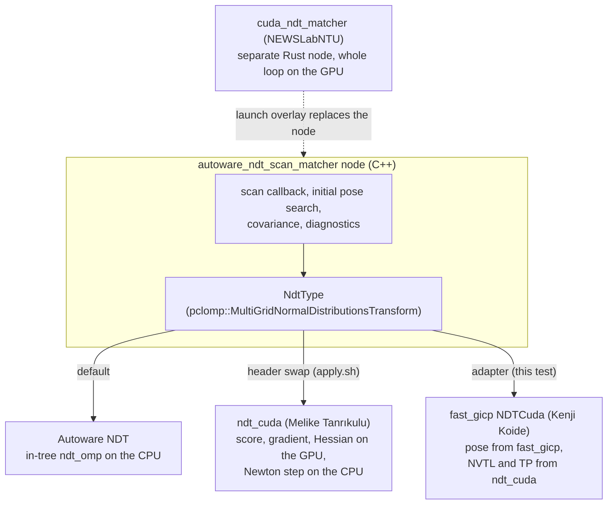

# The options

| Option | Owner | Repository and commit | Language | How it runs |
| --- | --- | --- | --- | --- |
| Autoware NDT (CPU) | Autoware Foundation | [autoware_core](https://github.com/autowarefoundation/autoware_core) `9662c30e` | C++, OpenMP | Autoware's own node, unchanged |
| ndt_cuda (Melike Tanrıkulu), original | Melike Tanrıkulu | [meliketanrikulu/ndt_cuda](https://github.com/meliketanrikulu/ndt_cuda) `192919b` | C++17, CUDA | Header swap in Autoware's node |
| ndt_cuda (Melike Tanrıkulu), fixed | Melike Tanrıkulu, with the fix of this benchmark | `192919b` and the fix | C++17, CUDA | Header swap in Autoware's node |
| cuda_ndt_matcher (NEWSLabNTU) | NEWSLabNTU (National Taiwan University) | [NEWSLabNTU/cuda_ndt_matcher](https://github.com/NEWSLabNTU/cuda_ndt_matcher) `99540d8` | Rust, CUDA C, CubeCL | Separate node in place of Autoware's |
| fast_gicp NDTCuda (Kenji Koide), adapter | Kenji Koide | [koide3/fast_gicp](https://github.com/koide3/fast_gicp) `0e7ec14` | C++, CUDA | Adapter in Autoware's node |

About the owners:

- Autoware NDT is part of `autoware_core` of the Autoware Foundation. Its NDT code is a copy of tier4/ndt_omp (TIER IV), which is a fork of koide3/ndt_omp (Kenji Koide).
- ndt_cuda is by Melike Tanrıkulu (GitHub `meliketanrikulu`). Its `integrations/autoware/apply.sh` swaps two headers of Autoware's node, and the node itself stays the same.
- cuda_ndt_matcher is from NEWSLabNTU, a GitHub organization of National Taiwan University. Its maintainer `jerry73204` (Jerry Lin, NTU) proposed it to Autoware. It replaces the whole Autoware node with its own node in Rust.
- fast_gicp is by Kenji Koide (GitHub `koide3`, AIST). It has no Autoware support, so I wrote an adapter for this benchmark that puts it into Autoware's node.

Related discussions and pull requests:

- [autowarefoundation/autoware#6905](https://github.com/orgs/autowarefoundation/discussions/6905): the proposal of cuda_ndt_matcher for Autoware
- [meliketanrikulu/ndt_cuda#2](https://github.com/meliketanrikulu/ndt_cuda/pull/2): the fix of the map upload stall
- [meliketanrikulu/ndt_cuda#3](https://github.com/meliketanrikulu/ndt_cuda/pull/3): the port of the integration to current Autoware

How each option plugs into Autoware:

ndt_cuda and the fast_gicp adapter run inside Autoware's own node, so every feature of the node stays: the initial pose search, covariance estimation, regularization, diagnostics and debug topics. cuda_ndt_matcher is a reimplementation of the whole node in Rust.

## Build details of each option

- Autoware NDT: the unchanged `autoware_ndt_scan_matcher` with its in-tree copy of tier4/ndt_omp.
- ndt_cuda (Melike Tanrıkulu), original: meliketanrikulu/ndt_cuda `192919b` with the Autoware main port (`patches/ndt_cuda/0002-feat-integrations-autoware-support-the-NDT-interface.patch`).
- ndt_cuda (Melike Tanrıkulu), fixed: the same plus `patches/ndt_cuda/0001-fix-gpu_backend-share-the-uploaded-map-between-copies.patch`.
- fast_gicp NDTCuda (Kenji Koide): the same node with an adapter that I wrote for this test. fast_gicp (`0e7ec14`, patched to compile with CUDA 12.8) computes the pose (P2D, DIRECT7, Levenberg-Marquardt). ndt_cuda's GPU kernels compute the transform probability and NVTL at that pose, because Autoware needs them and fast_gicp has none. Its GPU numbers include both. The adapter merges the loaded tiles into one cloud for fast_gicp, which builds its voxel map on the GPU in the map update thread.
- cuda_ndt_matcher (NEWSLabNTU): NEWSLabNTU/cuda_ndt_matcher `99540d8`, built for Jazzy without source changes. A launch overlay starts it in place of the Autoware node, with the same topics and Autoware's parameter file. It does not fill Autoware's `map_update_status` diagnostics, so its map update times come from its own log ("Map update: +N tiles").

The exact commits are in `config/versions.env`, and the patches are in `patches/`. See [Reproduce](reproduce.md).
