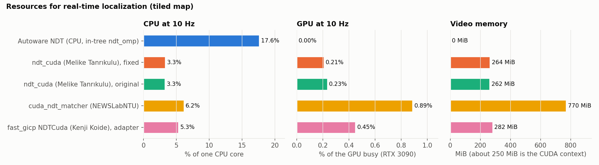
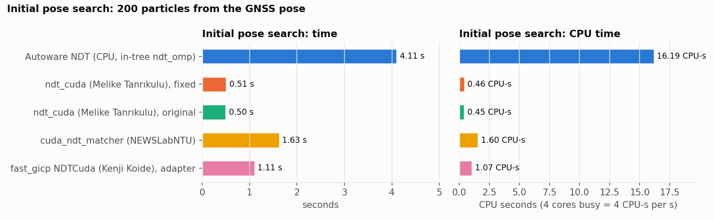
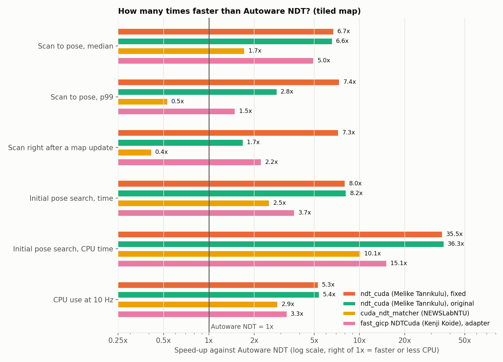
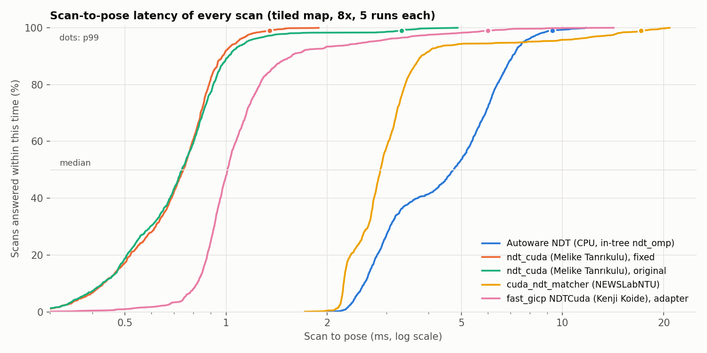

# Results

At the real 10 Hz scan rate, the GPU options cut the CPU use of localization by 2.8 to 5.3 times, and the time of the initial pose search by 2.5 to 8 times. The fixed ndt_cuda is the lightest on every measure. Its poses match Autoware's NDT to below a millimeter (median), and map updates no longer slow down its scans.

Tiled map (dynamic map loading swaps tiles while the vehicle drives, as on a real vehicle):

| Option | CPU at 10 Hz (% of one core) | GPU at 10 Hz (% busy, RTX 3090) | Scan to pose, median / p99 / max (ms) | Scan right after a map update, median / max (ms) | Initial pose search: time, CPU, GPU | RSS / VRAM (MiB) | Poses vs Autoware NDT, median |
| --- | --- | --- | --- | --- | --- | --- | --- |
| Autoware NDT (CPU, 4 threads) | 17.6 | 0 | 5.0 / 9.0 / 11.3 | 6.0 / 6.4 | 4.1 s, 16.2 CPU-s, 0 | 53 / 0 | 0.4 mm (run to run) |
| ndt_cuda (Melike Tanrıkulu), original | 3.3 | 0.23 | 0.76 / 3.2 / 4.2 | 3.5 / 4.2 | 0.50 s, 0.45 CPU-s, 0.30 GPU-s | 210 / 262 | 1.1 mm |
| ndt_cuda (Melike Tanrıkulu), fixed | 3.3 | 0.21 | 0.75 / 1.2 / 1.5 | 0.8 / 1.0 | 0.51 s, 0.46 CPU-s, 0.30 GPU-s | 204 / 264 | 0.8 mm |
| fast_gicp NDTCuda (Kenji Koide), adapter | 5.3 | 0.45 | 1.0 / 6.0 / 8.8 | 2.7 / 3.7 | 1.1 s, 1.1 CPU-s, 0.41 GPU-s | 394 / 282 | 296 mm |
| cuda_ndt_matcher (NEWSLabNTU) | 6.2 | 0.89 | 2.9 / 17.0 / 20.2 | 14.4 / 19.5 | 1.6 s, 1.6 CPU-s, 1.34 GPU-s | 512 / 770 | 3.9 mm |

How to read the columns:

- "CPU at 10 Hz" is the CPU time of the scan matcher process during one real-time (1x) replay, as a share of one core. 100 means one full core.
- "GPU at 10 Hz" is the time the GPU spent on the kernels and copies of the scan matcher process (Nsight Systems trace), per scan, times 10 scans per second.
- "Scan to pose" is the wall-clock time from the arrival of a scan to the arrival of its pose, seen by the same subscriber, from five 8x runs.
- "Scan right after a map update" is the scan-to-pose time of the first pose that arrives after each of the 5 map updates of the drive.
- The initial pose search is one call of `/localization/initialize` (GNSS pose, 200 particles, Autoware's default).
- VRAM includes the CUDA context, which takes about 250 MiB on this GPU and driver.

## Speed-up against Autoware NDT

Each value is the Autoware NDT value divided by the value of the option, on the tiled map. 6.0x means 6 times faster, or 6 times less CPU. A value below 1.0x means slower than Autoware NDT: 0.5x is twice as slow.

| Measure | ndt_cuda (Melike Tanrıkulu), original | ndt_cuda (Melike Tanrıkulu), fixed | fast_gicp NDTCuda (Kenji Koide), adapter | cuda_ndt_matcher (NEWSLabNTU) |
| --- | --- | --- | --- | --- |
| Scan to pose, median | 6.6x | 6.7x | 5.0x | 1.7x |
| Scan to pose, p99 | 2.8x | 7.4x | 1.5x | 0.5x |
| Scan right after a map update, median | 1.7x | 7.3x | 2.2x | 0.4x |
| Initial pose search, time | 8.2x | 8.0x | 3.7x | 2.5x |
| Initial pose search, CPU time | 36.3x | 35.5x | 15.1x | 10.1x |
| CPU use at 10 Hz | 5.4x | 5.3x | 3.3x | 2.9x |

The GPU options also use the GPU, which Autoware NDT does not (0.2% to 0.9% of an RTX 3090 at 10 Hz, see the table above). The ratios compare time and CPU use only. The sample scans are small (about 750 points after downsampling), so fixed costs per scan (ROS 2 messages, kernel launches, copies) take a large share of the GPU options' time. With larger scans the speed-up of the scan matching itself is larger: in ndt_cuda's own benchmark it grows from 19x at 16000 points to about 100x at 5 million points.

## Tracking, 8x replay, tiled map (5 runs per option, median of the run values)

| Option | Poses / scans | Latency median (ms) | p99 (ms) | max (ms) | After a map update, median (ms) | After a map update, max (ms) | `exe_time_ms` median | CPU per scan (ms) | vs Autoware NDT, median (mm) | vs Autoware NDT, max (mm) |
| --- | --- | --- | --- | --- | --- | --- | --- | --- | --- | --- |
| Autoware NDT | 290/293 | 5.02 | 9.03 | 11.27 | 5.98 | 6.38 | 4.57 | 18.16 | 0.4 | 26.7 |
| ndt_cuda (Melike Tanrıkulu), original | 290/293 | 0.76 | 3.19 | 4.22 | 3.54 | 4.22 | 0.41 | 1.60 | 1.1 | 32.2 |
| ndt_cuda (Melike Tanrıkulu), fixed | 290/293 | 0.75 | 1.23 | 1.49 | 0.82 | 1.00 | 0.41 | 1.51 | 0.8 | 25.1 |
| fast_gicp NDTCuda (Kenji Koide), adapter | 279/293 | 1.01 | 6.03 | 8.77 | 2.68 | 3.65 | 0.68 | 3.61 | 296.2 | 632.0 |
| cuda_ndt_matcher (NEWSLabNTU) | 290/293 | 2.91 | 16.95 | 20.19 | 14.36 | 19.48 | 2.76 | 4.44 | 3.9 | 25.2 |

Each curve shows the share of scans answered within a given time. Further left is faster, and a curve that rises steeply has few slow scans.

The Autoware NDT row compares runs 2 to 5 with run 1, so it shows how much the replay itself varies.

## Tracking, 8x replay, single-file map

| Option | Poses / scans | Latency median (ms) | p99 (ms) | max (ms) | `exe_time_ms` median | CPU per scan (ms) | vs Autoware NDT, median (mm) | vs Autoware NDT, max (mm) |
| --- | --- | --- | --- | --- | --- | --- | --- | --- |
| Autoware NDT | 290/293 | 4.68 | 8.38 | 10.11 | 4.32 | 17.21 | 0.2 | 27.3 |
| ndt_cuda (Melike Tanrıkulu), original | 290/293 | 0.81 | 1.45 | 1.80 | 0.51 | 1.57 | 0.9 | 31.5 |
| ndt_cuda (Melike Tanrıkulu), fixed | 290/293 | 0.79 | 1.39 | 1.63 | 0.46 | 1.55 | 0.6 | 23.4 |
| fast_gicp NDTCuda (Kenji Koide), adapter | 280/293 | 1.03 | 5.50 | 8.80 | 0.70 | 2.49 | 256.7 | 682.8 |
| cuda_ndt_matcher (NEWSLabNTU) | 290/293 | 2.96 | 17.18 | 20.30 | 2.87 | 4.09 | 3.9 | 25.1 |

Without tile changes, the original and fixed ndt_cuda behave the same, as expected.

## Replay rate, tiled map

| Option | 1x | 8x | 16x | p99 latency at 1x / 8x / 16x (ms) |
| --- | --- | --- | --- | --- |
| Autoware NDT | 291/293 | 290/293 | 281/293 | 7.5 / 9.0 / 14.1 |
| ndt_cuda (Melike Tanrıkulu), original | 290/293 | 290/293 | 290/293 | 2.9 / 3.2 / 3.2 |
| ndt_cuda (Melike Tanrıkulu), fixed | 291/293 | 290/293 | 290/293 | 1.6 / 1.2 / 1.3 |
| fast_gicp NDTCuda (Kenji Koide), adapter | 276/293 | 279/293 | 242/293 | 5.3 / 6.0 / 10.6 |
| cuda_ndt_matcher (NEWSLabNTU) | 290/293 | 290/293 | 290/293 | 16.5 / 17.0 / 20.8 |

The first columns are poses per scan. At 16x (160 scans per second), Autoware NDT starts to lose scans, and fast_gicp loses about 17%. In an earlier matrix on the single-file map, all options lost about half the scans at 32x, so above 16x the replay chain itself is the limit.

## All generated tables

`harness/summarize.py` writes these tables from the per-run data in `results/runs/`. They include every measure of every run group.

--8<-- "results/summary.md"
